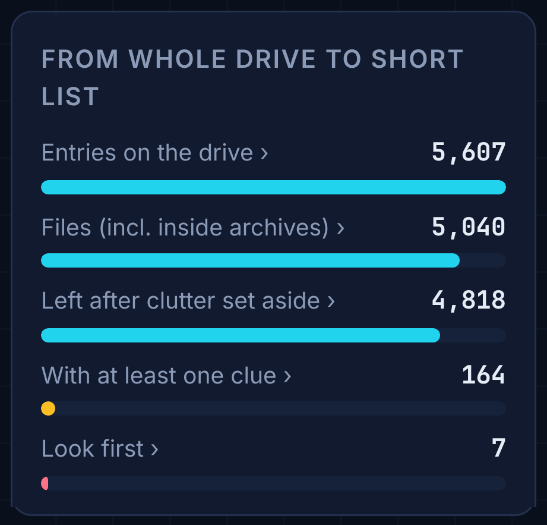
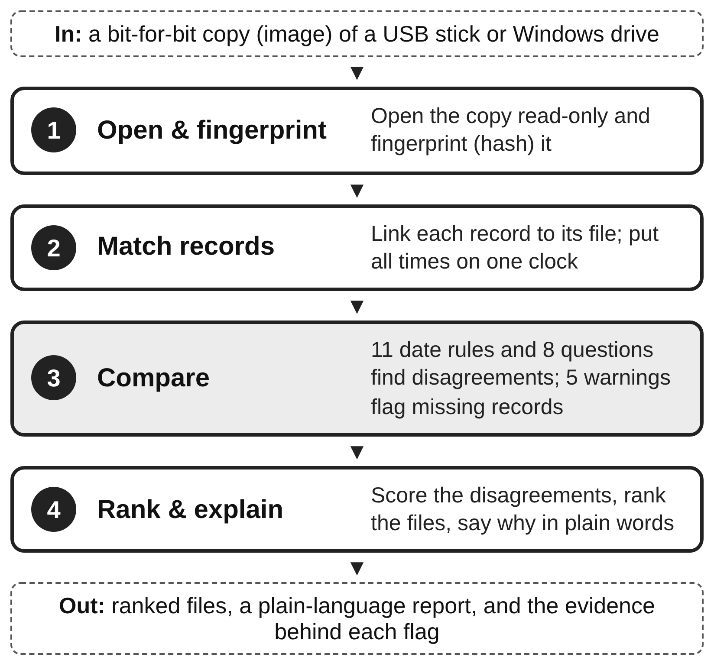
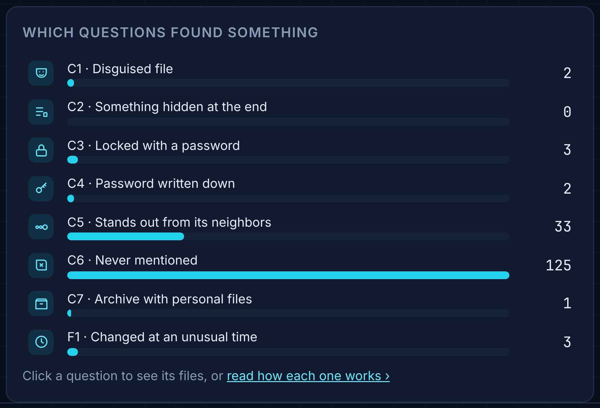
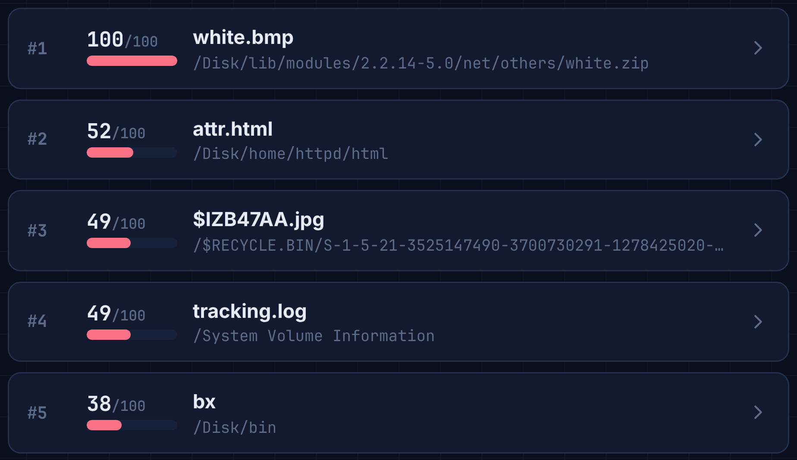
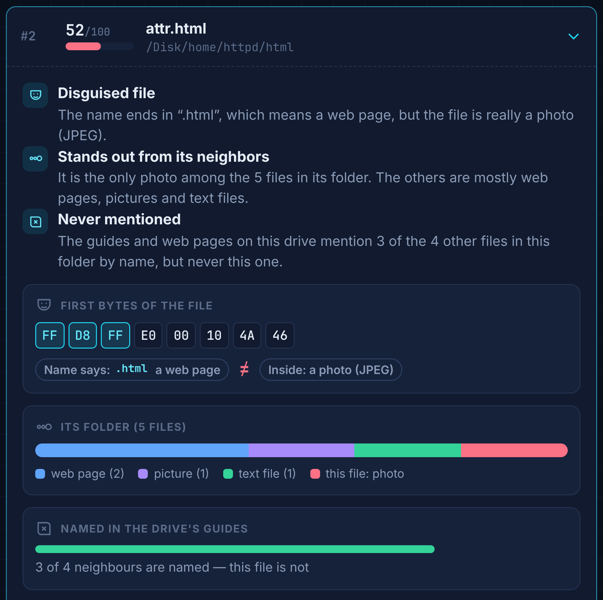
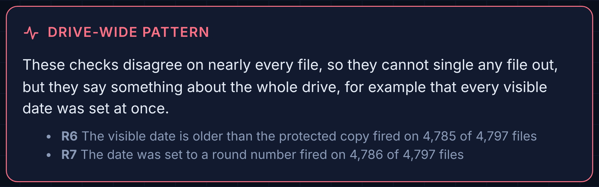

::: abstract
People hiding evidence on a computer can change a file's dates, rename a photo so it looks like a program, or tuck one file inside another, each in a few seconds. But Windows and its file system write the same facts down in several separate places, and a cover-up rarely changes all of them. I built the Artifact Disagreement Scorer, a tool that compares these records with each other and points the examiner to the files where they disagree, with a plain-English reason for each one. It runs as a command-line program or as a single web page that works offline. I am testing it on the two disk images from this course's lab projects, using my own findings from EnCase and the Forensic Toolkit (FTK) as the answer key. On Project 1 it ranked six of the seven evidence files in its top ten out of 2,246 files. On Project 2, where the checks were locked before I examined the image, it found seven of the sixteen evidence files among 4,818, five of them in its top ten.
:::

::: keywords
Digital forensics, anti-forensics, timestamp tampering, NTFS, triage, tool validation
:::

# The Problem

Hiding evidence is cheap. Any program can rewrite the dates Windows shows for a file, a trick called *timestomping* [1]. A photo can be renamed *gzip* so it sits among system programs, and a file can be hidden inside a ZIP or after the end of another file.

Hiding it *well* is much harder. Windows records the same facts in more than one place, written by different parts of the system for different reasons. Windows' file system (NTFS) keeps a second, harder-to-reach copy of every file's dates. Windows writes a shortcut file when a document is opened, a Prefetch file when a program runs, and event logs for logons and clock changes. A file's name says what it should be, and its first bytes say what it really is. Someone covering their tracks may fix one of these, but rarely all of them, so a cover-up leaves records that *disagree*.

Today's tools leave that comparison to the examiner. EnCase and the Forensic Toolkit display every record, but the examiner has to notice that two of them conflict. Specialized tools automate a single check, and a single check is noisy: normal use also produces odd dates, so one filter can return hundreds of files.

The question for this paper is the one from my topic proposal: *does combining many disagreement checks point an examiner to hidden evidence better than any single check?* To answer it I built the Artifact Disagreement Scorer. Fig. 1 shows the front page of its report on the Project 2 image: of 5,607 entries on the drive, 164 files have at least one clue and 7 are marked "look first".

{width=column}

Section II covers what already exists, Section III shows how the tool works, and Section IV explains how I am testing it.

# What Already Exists

**Two copies of every date.** Windows' file system keeps a table with one entry per file (the Master File Table). Each entry holds four dates, for when the file was created, last changed, last opened, and when its entry last changed. It holds them *twice*. The **visible dates** (formally, Standard Information) are what Windows Explorer shows, and any program can change them. The **protected dates** (formally, File Name) are kept by the file system itself and cannot be set the normal way. When the visible dates say a file is older than the protected dates do, something is off.

**Single checks.** Chow and colleagues listed the rules that these dates follow in normal use [2]. Willassen [3] showed that the order in which files were laid down on disk, like layers of rock, can expose a file that claims to be older than its neighbors. Magnet AXIOM, a commercial tool, flags files whose visible and protected dates disagree [4], which is just one of my tool's checks on its own. EnCase and the Forensic Toolkit compare a file's name with its first bytes, another single check. Timeline tools put records in time order but do not test whether they agree.

**Combining records.** The closest work is Palmbach and Breitinger [5]. They showed that the change journal, shortcut files, Prefetch and event logs all keep traces of timestamp changes, concluded that none is reliable alone, and proposed five rules that use them together. Vanini, Hargreaves and Breitinger [6] proposed a way to rate how hard each *type* of record is to fake.

**What is missing.** Each of these stops short in a way that matters to an examiner:

- Palmbach and Breitinger [5] recommend combining sources but never measure whether combining helps. Their test used four files on an unused computer, so it cannot say how often ordinary activity sets off their rules.
- Vanini and colleagues [6] rate record types in general, not whether a particular drive shows tampering.
- The single checks are each easy to dodge or to trip by accident, and the commercial tools leave it to the examiner to connect them.

No one has measured, on the kind of images an examiner actually receives, whether combining these checks finds planted evidence faster than the best single check. That is the gap my tool is built to test.

# How the Tool Works

## The Idea in One Picture

The Artifact Disagreement Scorer opens an exact copy of a drive without changing it, lines up each file's records, asks two sets of questions, and ranks the files by how many independent questions disagree about them (Fig. 2). Four goals shape it:

1. **Combine; never trust one check.** A file rises only when several independent checks disagree about it, so normal noise in one record does not put it at the top.
2. **A missing record is a clue.** Deleting a record is often easier than faking one [5], so the tool reports records that were cleared or are missing instead of quietly skipping the checks that need them.
3. **Explain every flag.** Each flag comes with a plain sentence and the values behind it, so an examiner can state and defend why a file was picked.
4. **Usable by non-specialists.** Findings go to investigators, lawyers and commanders. The tool runs from the command line or as one web page that works offline, and its report is written in plain English.

{width=2.9in}

**Scope.** Copies of USB sticks (the FAT file system) and Windows drives (the NTFS file system). The date rules target changes made from inside a running Windows system; editing a raw disk offline bypasses Windows' own logs and is out of scope.

## Where the Analysis Starts: the Drive Itself

Before any file is judged, the report shows what the drive says about itself (Fig. 3). The first sector of every drive, the *boot sector*, describes its layout: how big a sector is, how many there are, and where the file table sits. The tool decodes it field by field. Hovering a field lights up its bytes, shows how they are read (numbers are stored with their bytes in reverse order), and marks the same field in the list on the right. The rows of start-up code are folded away, and one click shows all 512 bytes. This gives the examiner a reference point before the leads, and a quick way to confirm the tool read the drive correctly.

{width=page}

## Eight First-Look Questions, for Any Drive

Many drives an examiner receives are not Windows system drives: a USB stick, or a data drive full of another system's files. So the tool first asks eight questions of every file, each comparing what a file claims to be with what it holds. Fig. 4 shows them as the report lists them, with how many files each one flagged on Project 2. For example, *disguised file* (C1) compares a file's name with its first bytes; *stands out from its neighbors* (C5) finds the only photo in a folder of programs; *never mentioned* (C6) finds a file that the folder's own guides and web pages never name, though they name its neighbors; and *changed at an unusual time* (F1) finds a file written apart from the bulk copy around it.

{width=column}

## Eleven Date Rules for Windows Drives

Windows keeps five records that the date rules compare (Table I). Each is written by a different part of Windows, which is what makes their agreement meaningful.

Table: The records the date rules compare

| Record | Written by | What the tool uses |
|---|---|---|
| Master File Table | File system | Visible and protected dates (8 per file) |
| Change journal | File system | When files were created and their dates changed |
| Shortcut files | Windows Explorer | Their own dates, and a copy of the target's dates |
| Prefetch files | Windows | Which programs ran, and their last 8 run times |
| Event logs | Windows | Logons, log clearing, clock changes |

Table II lists the rules in the same plain words the report uses. Each rule answers *consistent*, *violated*, or *cannot check* when a record it needs is missing.

Table: The date rules

| Rule | Flags a file when... | From |
|---|---|---|
| R1 | Its record-change date is before the journal's own entry | [5] |
| R2 | A shortcut disagrees on its last-change date | [5] |
| R3 | A shortcut is older than the file it points to | [5] |
| R4 | A shortcut was opened after the file's last-opened date | [5] |
| R5 | It changed while nobody was logged on | [5] |
| R6 | Its visible date is older than the protected copy | [4] |
| R7 | Its date was set to a round number of seconds | Known |
| R8 | It was created later than its visible date says | New |
| R9 | A shortcut remembers a different creation date | New |
| R10 | Its date changed as an unusual program ran | [5] ext. |
| R11 | It claims to be much older than its neighbors on disk | [3] |

R8 and R9 are the main new rules. The change journal's "file created" entry is not touched when someone later rewrites the visible dates, so a journal entry dated well after the claimed creation date is strong evidence of back-dating. Every shortcut also keeps a copy of its target's dates, so a creation date that has since moved is suspicious even when the shortcut's own dates look normal. Five warnings (S1 to S5) keep missing records visible: a cleared event log, a deleted or late-starting change journal, gaps in the event log numbering, a changed system clock, and programs that ran without leaving a Prefetch file. Any "consistent" answer that rests on a damaged record is marked low-confidence.

## Scoring: Agreement Beats Noise

Both sets of checks are scored the same way. A file's score is the weighted share of the checks that fired, out of the checks that could be run on it:

$$ D(f) = \frac{\sum_r w_r \, v_r(f)}{\sum_r w_r} $$

Here v_r(f) is 1 if check r fires for file f and 0 if not. A check that fires on almost every file says little, so each weight is w_r = ln(1/p_r), where p_r is how often check r fires on that drive: a check that fires on 2% of files counts for more than one that fires on 20%. For the date rules, records that a user cannot easily reach (the change journal, the protected dates) also count up to three times more than records a user can edit or delete (shortcuts, Prefetch), using the tamper-resistance ratings of Vanini and colleagues [6]. To my knowledge this is the first use of those ratings as a number inside a detector. A simple weighted sum was chosen over machine learning because there is no labelled training data and because a sum keeps every flag explainable. Fig. 5 shows the result on Project 2: the files ranked by score.

{width=column}

## Every Flag Explained

Opening a lead shows why it was picked (Fig. 6). For *attr.html*, three independent questions agree: its name says web page but its first bytes (FF D8 FF) say photo; it is the only photo in its folder; and the drive's guides and web pages name three of its four neighbors but never this file. Each line is a sentence an examiner can repeat in a report, with the evidence printed under it.

{width=2.6in}

## Implementation

The tool is written in Python 3 using only its standard library, so it runs on any computer with Python installed. It reads the drive copies itself and never writes to them. Both of its drive readers were checked against The Sleuth Kit, a standard open-source forensic toolkit: the USB-stick reader matched it byte for byte on all 4,923 files of the Project 1 image, and the Windows-drive reader matched it on a test image built with fragmented, linked, hidden and deleted files, and on 3,605 files of a larger image. Every input is fingerprinted with SHA-256. The same code produces the "one check only" results that the evaluation compares against. A browser edition puts the whole tool in a single offline web page, and it gives exactly the same results as the command line on both course images. The code passes 59 automated tests.

# How I Am Testing It

The test is simple: on drives I did not build, does the tool point an examiner to what a careful manual examination found, and how much reading does that take?

## Four Questions

1. **Does it point to the evidence?** What share of the evidence files I found by hand does it list, and how far down?
2. **Is combining better?** For the same number of files reviewed, does the combined ranking reach more evidence than any single check alone?
3. **Does it hold up on a drive it was not tuned on?**
4. **Can a non-specialist follow it?** Does the report alone explain each flag, and how long does a run take?

## The Two Course Drives

Table III summarizes the two drives. I examined both by hand before running the tool, so each has an answer key.

Table: The two course drives

| | Project 1 | Project 2 |
|---|---|---|
| Drive | External drive (FAT16, as on USB sticks) | Windows-formatted (NTFS) volume of copied Linux files |
| Examined by hand with | EnCase | Forensic Toolkit |
| Answer key | 7 evidence files, 2 decoys | 16 evidence files, 3 decoys |
| Role | Development | Held-out test |

**Answer keys.** For each drive I listed the files that answered a case question (the evidence) and the files planted to mislead (decoys), with how I found each by hand. A file the tool lists that is not in the key is not necessarily a false alarm: the key is one examiner's findings.

**Locking the checks.** I wrote the eight first-look questions after examining Project 1, so its result is a demonstration, not a test. The questions were committed on October 20, before I examined Project 2, and an automated test fails if they change. That makes Project 2 a fair, held-out test. Reading Windows-formatted drives was added later, but it only reads the drive and changes no question. Any later change to a question will be reported separately.

**Date rules on real data.** Project 2 uses Windows' file system, so the three date rules that need only the file table (R6, R7, R11) run on it directly. It holds Linux files with no shortcuts, Prefetch files or Windows event logs, so the other rules are tested on made-up cases instead. There is no answer key for date tampering on this drive, so this part reports what the date rules found.

## What I Measure

For each drive: how many evidence files the tool lists and where each one ranks; how many are in the top ten; how many files an examiner must read to reach every evidence file it found (the *review depth*); and how many decoys it lists. To compare with single checks, each check gets the same budget: if a check flags 12 files, it is compared with the tool's top 12. For readability, I check that every flag in the top twenty is explained by the report alone, and I time each run.

## Results So Far

**Project 1 (development).** Out of 2,246 files the tool listed 76. All 7 evidence files were among them, 6 in the top ten and all in the top 16; both decoys were listed too. No single check caught more than 4 of the 7. The broad checks lost clearly: *changed at an unusual time* (F1) flags 12 files and caught 4, while the tool's top 12 held 6. The two narrowest checks, which flag one file each, did better at a budget of one file, because the tool's top file was a decoy.

**Project 2 (held-out test).** With the questions locked, the tool listed 164 of 4,818 files. 7 of the 16 evidence files were among them, 5 in the top ten and all in the top 15; one of the 3 decoys was listed. That is less than half of the evidence, and the narrowest checks again won at budgets of one to three files. Every top-twenty flag has a plain-English explanation, and each of the nine missed files is explained by something the tool does not read, such as document properties, page text, or a password written as "pswd =". On a Windows PC the first look checked all 4,818 files in 34 seconds and the date checks took 4.9 seconds; the browser edition took 35 seconds and gave the same results.

The date rules found something different: a pattern across the whole drive (Fig. 7). The visible date is older than the protected copy (R6) on 4,785 of 4,797 files, and the date was set to a round number (R7) on 4,786. Nearly every visible date had been set to one moment, 2 Oct 2011 at 11:57:01, while the protected dates show the files were really written in two batches six years apart. Because these rules fire on almost every file, their weight drops to nearly zero and they single out no file; the report raises them as a finding about the drive instead.

{width=column}

## Success Criteria (Set Before Project 2)

On Project 2: (1) the tool lists at least half of the evidence files; (2) for every single check, the tool's top files hold at least as many evidence files as that check does with the same budget; (3) every top-twenty flag is explained by the report alone; and (4) every missed evidence file is explained by what the tool does and does not examine. Criteria 1 and 2 were not met, and that is reported as found. Criteria 3 and 4 appear met; criterion 3 gets a final readability check for the final paper.

## Limits of This Test

Two drives are a small sample. Each answer key is one examiner's findings and may be incomplete. Both drives are teaching cases with planted evidence, not real adversaries. I wrote the checks myself, which is why Project 1 counts only as development. The Windows-only date rules meet real data only through the file table; the rules that need shortcuts, Prefetch and event logs are tested on made-up cases.

## Status and Next Steps

Done: the tool, both drive readers, the answer keys, and the runs on both projects. The Project 1 result reproduced exactly on a second computer, and the browser edition matched the command line on both drives. For the final paper (December 6): the full Project 2 results, a readability check of the top-twenty sentences, and what the misses teach about where the tool should look next.

# References

::: references
[1] MITRE, "Indicator Removal, Technique T1070," MITRE ATT&CK. [Online]. Available: https://attack.mitre.org/techniques/T1070/

[2] K.-P. Chow, F. Y. Law, M. Y. Kwan, and P. K. Lai, "The rules of time on NTFS file system," in *Proc. 2nd Int. Workshop Systematic Approaches to Digital Forensic Engineering (SADFE)*, 2007, pp. 71–85.

[3] S. Y. Willassen, "Finding evidence of antedating in digital investigations," in *Proc. 3rd Int. Conf. Availability, Reliability and Security (ARES)*, 2008, pp. 26–32.

[4] R. Andrade, "Expose evidence of timestomping with the NTFS timestamp mismatch artifact," Magnet Forensics, 2020.

[5] D. Palmbach and F. Breitinger, "Artifacts for detecting timestamp manipulation in NTFS on Windows and their reliability," *Forensic Sci. Int.: Digit. Investig.*, vol. 32, 300920, 2020.

[6] C. Vanini, C. Hargreaves, and F. Breitinger, "Evaluating tamper resistance of digital forensic artifacts during event reconstruction," arXiv:2412.12814, 2024.
:::
